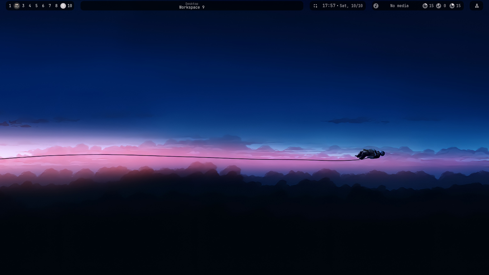
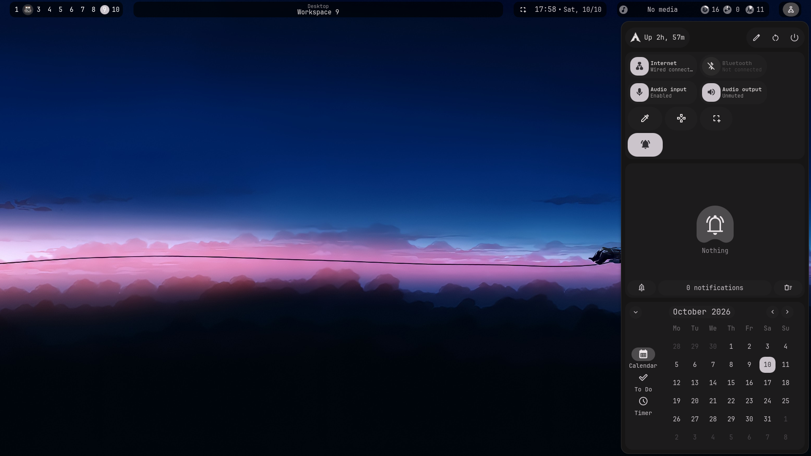
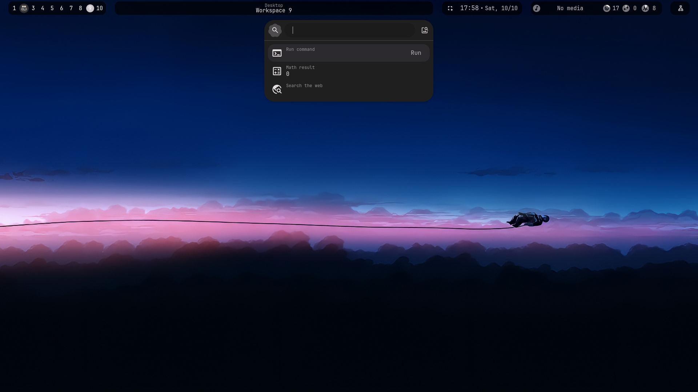
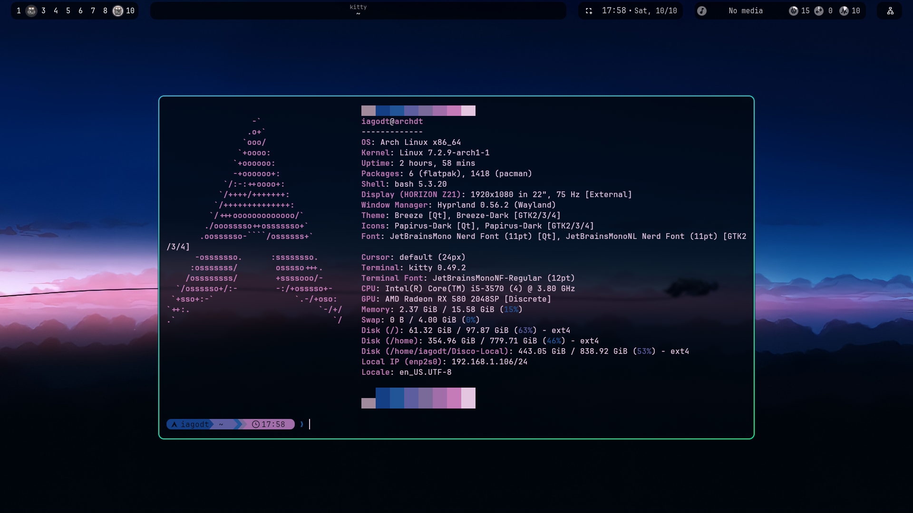
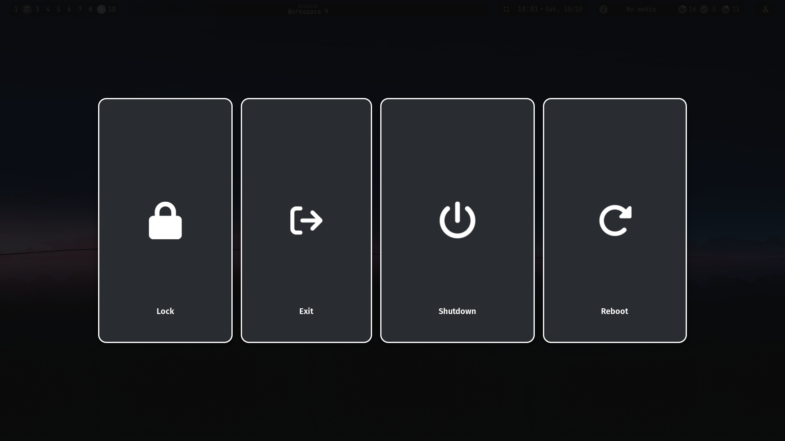
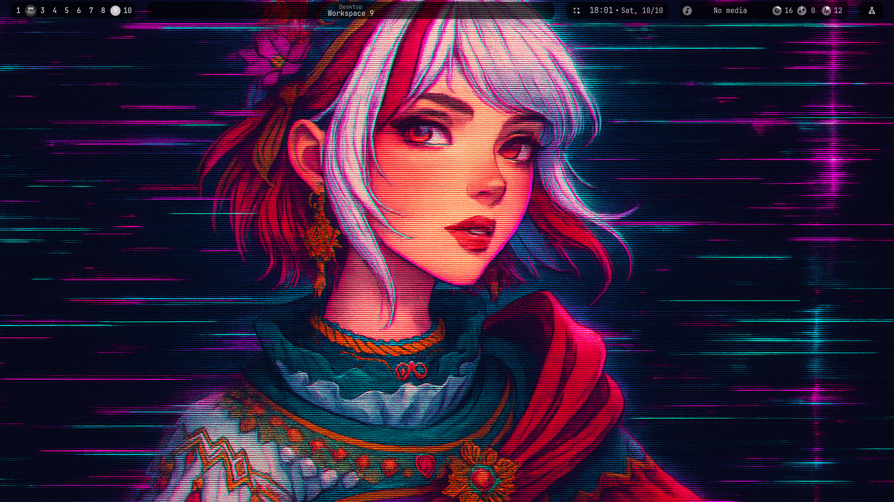

# ArchDT-dots

Meu setup Arch + Hyprland com theming dinâmico (pywal + awww + Quickshell).

## Showcase

| Desktop limpo | Bar + Sidebar |
|---|---|
|  |  |

| Overview / Launcher | Terminal + fastfetch |
|---|---|
|  |  |

| wlogout | Tema alternativo (pywal dinâmico) |
|---|---|
|  |  |

As cores mudam dinamicamente com o wallpaper via `pywal`: kitty, starship, gtk/qt e o shell Quickshell acompanham o tema.

## Stack

| Parte | App |
|---|---|
| Compositor | Hyprland (config modular em `hypr/conf/*.conf`) |
| Shell/bar/launcher | Quickshell (`quickshell/archdt/`, `qs -p ~/.config/quickshell/archdt/`) |
| Terminal | kitty + starship (gerado pelo pywal em `wal/templates/starship.toml`) |
| Wallpaper | awww-daemon + waypaper (backend `awww`) + timer `change_wallpaper` |
| Theming | pywal, qt5ct/qt6ct, nwg-look, Papirus-Dark |
| Files | dolphin, ark, kio-admin |
| Clipboard/emoji | cliphist + wl-paste, fuzzel-emoji |
| Screenshots | grim + slurp (via Quickshell region) |
| Logout | wlogout |

## Atalhos principais (`$mainMod = SUPER`)

| Teclas | Ação |
|---|---|
| `SUPER + T / E / P` | kitty / dolphin / vivaldi |
| `SUPER + SPACE` | launcher (quickshell overview) |
| `SUPER + V / .` | clipboard / emoji |
| `SUPER + /` | cheatsheet |
| `SUPER + C / TAB / ENTER` | fechar / float / fullscreen |
| `SUPER + 1..0` | workspaces |
| `ALT + TAB` | hyprview (alternar janelas) |
| `SUPER + SHIFT + S / R` | screenshot / screen record |
| `SUPER + SHIFT + W` | wallpaper aleatório |

Lista completa em `DOTS/hypr/conf/binds.conf` (59 binds).

## Instalação

### Opção A — Arch do zero (meu fluxo pessoal)

Uso o repo [ArchDT](https://github.com/IagoMonte/ArchDT) (`user_configuration.json` do archinstall). Ele já clona este repo e faz `cp -rn DOTS/* ~/.config/`. Bom para VM/maquina nova.

### Opção B — Standalone (este repo, qualquer Arch existente)

```bash
git clone https://github.com/IagoMonte/ArchDT-dots.git
cd ArchDT-dots
./install.sh --check   # dry-run, veja o que vai fazer
./install.sh           # default: symlink (convencao)
# ou modo robusto, nao quebra se mover o repo:
./install.sh --copy
```

Opções: `--copy` (cp -rn no lugar de symlink), `--no-packages` (pula pacman/yay), `--backup DIR`, `--check` (dry-run).

O script:
1. Instala pacotes pacman (hyprland, kitty, quickshell, awww, starship, etc) + AUR (`wlogout`, `waypaper`, `python-pywal`) via yay (instala o yay se faltar).
2. Backup com timestamp em `~/.config-backup-archdt-*`.
3. Linka (ou copia) `DOTS/* -> ~/.config/*`. Pula `dconf/user` (binário local) e `k500Profiles` (pessoal do meu teclado).
4. `.bashrc` + `Wallpaper/` (sempre cópia no-clobber).
5. Habilita `swww.service` (awww-daemon), `change_wallpaper.service/.timer`.
6. Roda `wal` no primeiro wallpaper e linka `~/.cache/wal/starship.toml -> ~/.config/starship.toml`.

> Sem ProfileSwitcherK500 aqui — é coisa do meu teclado, fica fora do standalone.

### Pós-instalação

```bash
# recarregar shell/bar
qs -p ~/.config/quickshell/archdt/
# trocar wallpaper + tema
waypaper
# ou aleatório
~/.config/swww/swww.sh
wal -i ~/Wallpaper/current/<arquivo>
```

## Estrutura do repo

```
ArchDT-dots/
├── .bashrc                  # prompt starship + aliases
├── Wallpaper/current/       # 140+ wallpapers
├── DOTS/                    # espelho de ~/.config/
│   ├── hypr/conf/*.conf     # hyprland modular (binds, autostart, layouts...)
│   ├── quickshell/archdt/   # shell (bar, sidebar, overview, OSD...)
│   ├── kitty/kitty.conf     # inclui colors-kitty do pywal
│   ├── wal/templates/       # starship.toml gerado pelo pywal
│   ├── swww/                # swww.sh (awww) + pywal.sh
│   ├── systemd/user/        # swww + change_wallpaper timer
│   ├── waypaper/, wlogout/, qt5ct/, qt6ct/, gtk-*/
│   └── kdeglobals, dolphinrc, mimeapps.list
├── install.sh               # instalador standalone
├── packages.txt             # pacman -Qqe (191 pkgs)
├── packages-repo.txt / packages-aur.txt
└── assets/screenshots/      # prints do showcase
```

## Theming dinâmico

- `awww img <wall> && wal -i <wall>` gera paleta em `~/.cache/wal/`.
- kitty lê `~/.cache/wal/colors-kitty.conf`, starship é link simbólico para o gerado.
- Quickshell `archdt` com `wallpaperTheming.enableAppsAndShell`.
- Timer `change_wallpaper.timer` troca a cada hora (`OnCalendar=hourly`).

## Troubleshooting

- **Bar não aparece:** `qs -p ~/.config/quickshell/archdt/` — veja erro no terminal; cheque `quickshell` instalado.
- **Wallpaper preto:** `systemctl --user status swww` — o ExecStart atual é `awww-daemon`, não `swww-daemon` (migração feita neste update).
- **Cores não mudam:** rode `wal -i <wallpaper>` manual e cheque `~/.cache/wal/`.
- **Login quebrou após symlink:** restaure de `~/.config-backup-archdt-*` ou rode `./install.sh --copy`.

## Créditos

- Shell Quickshell `archdt` (baseado no ecossistema Quickshell).
- Inspirado em setups Hyprland + pywal da comunidade.
